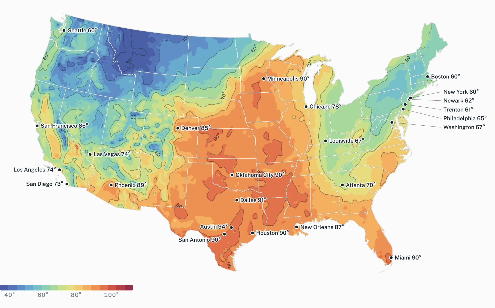
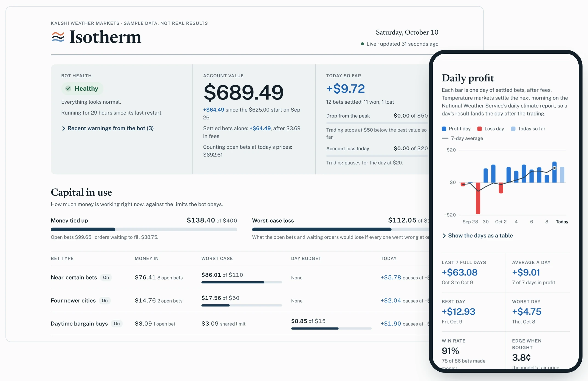
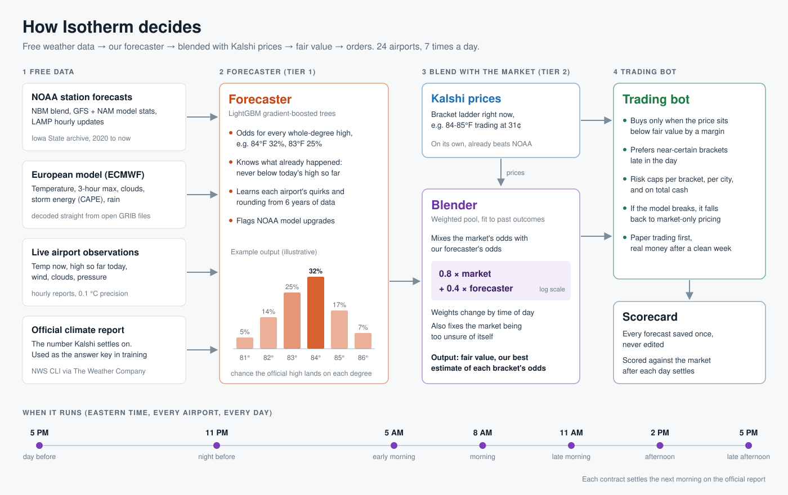

<picture>
  <source media="(prefers-color-scheme: dark)" srcset="docs/assets/lockup-dark.png">
  
</picture>

**Isotherm forecasts the day's high temperature and trades on it.** It runs around the clock on
[Kalshi](https://kalshi.com)'s daily temperature markets in 24 U.S. cities, built entirely on free NOAA and ECMWF
data. Each forecast is blended with live market prices, and Isotherm only trades where the price sits far enough from
its estimate. It has traded real money since October 2026.

[Product site](https://shourya0mehta.github.io/isotherm/) &nbsp;&nbsp; [How it works](#how-it-works) &nbsp;&nbsp;
[Run it](#running-it)

[](https://github.com/shourya0mehta/isotherm/actions/workflows/tests.yml)



<sub>The day's high across the lower 48 from NOAA's 3 km HRRR model, with the official high in each city Isotherm
trades. Lines are isotherms, 10 °F apart.</sub>

## The dashboard

A private dashboard shows the account, the money at risk against every limit, profit by day, and which cities and bet
types are working. The trading server publishes encrypted numbers to GitHub every minute (AES-256-GCM, with the key
derived from a passcode by PBKDF2), and the page decrypts them on the device, so it stays live on any phone without a
laptop running anywhere.



## A day in the market

Every city gets a new market each day, split into 2 °F brackets. Isotherm re-forecasts at set times, keeps its
quotes fresh in between, and holds every position until the official report settles it.

| Time (Eastern) | What happens |
|---|---|
| 10 AM, the day before | Kalshi lists the brackets for tomorrow's high |
| 11 AM and 2 PM | Early bets, where the forecast's edge over the market is largest |
| 5 PM and 11 PM | Night-before forecasts from the evening model runs |
| 5 AM to 5 PM | Forecasts refresh every three hours, and live sensor readings rule out brackets the high has passed |
| 11:59 PM | Trading closes |
| 7 AM, the next morning | Markets settle on the National Weather Service's daily climate report, East Coast first |

This is a partial public copy of a private repository. The code, tests and core research scripts are here. Keys,
live configs, trained models, market data and deployment scripts are not.
The code lives in the `wxbot` Python package.

## How it works



### 1. Free data

| Source | What it gives |
|---|---|
| NOAA guidance via the [Iowa Environmental Mesonet](https://mesonet.agron.iastate.edu) archive | National Blend of Models, GFS and NAM model output statistics, LAMP hourly updates (2020 onward) |
| NOAA HRRR on AWS | 3 km hourly model, rest-of-day max at the nearest grid point |
| ECMWF open data on AWS | European model 2 m temperature, read one GRIB field at a time with byte-range requests |
| ASOS/METAR airport sensors | Temperature now, high so far today, 0.1 °C readings and 6-hour max groups |
| NWS daily climate report | The official daily high, used as the training label |

Every input is lined up with the time it actually became public, so training never sees anything the live bot
couldn't have seen at that hour.

### 2. Forecaster (`wxbot/ml/`)

A LightGBM classifier predicts a probability for every whole degree of the official high, at seven decision times
from the evening before through the afternoon of the day.

- It predicts offsets from an anchor (the latest blended NOAA forecast, raised to the observed high once the day has
  started), so one model serves all 24 cities and all hours.
- Predicting whole degrees directly means the rounding rules, the gap between hourly and 5-minute peaks, and the
  fact that the high can't drop below what has already happened are all learned from labels instead of assumed.
- Station inputs and each model's recent misses at that station let it learn local biases.

The evening before, its average miss is **1.57 °F** against **1.92 °F** for the best single NOAA product, and it beats
that product in all 24 cities.

### 3. Blending with the market (`wxbot/ml/live.py`, `wxbot/ml/pool_fit.py`, `research/ml/cgep.py`)

The market is sharper than any single forecast, so Isotherm doesn't try to replace it. For each decision hour it pools
the market's bracket probabilities `m` with the forecaster's `f`:

```
p_b  ∝  m_b^α · f_b^β · exp(θ·z_b + κ·z_b²)
```

`z_b` is each bracket's center relative to the market's mean. With `β = 0` this reduces to recalibrating the market,
which is too unsure of itself on its own. The weights are fit by maximum likelihood (L-BFGS with an analytic
gradient; the problem is concave, so there is one optimum) on the last 90 days and refit every week.

One extra term shifts the weights by how far the headline NOAA forecast sits from the market's mean. Traders lean on
that number, and the pool learns to lean the other way when it is off.

### 4. Trading and risk (`wxbot/strategy/`, `wxbot/risk/`, `wxbot/execution/`)

- **Market making:** post-only orders on near-certain brackets, plus a separate maker for newly listed cities with
  wide spreads. Live observations rule out brackets the day has already passed.
- **Taking:** immediate-or-cancel orders when the pooled forecast beats the price by the fee plus a margin, both
  the day before (where the forecaster's edge is largest) and during the day.
- **Caps** on worst-case loss per bracket, per event and in total, plus a cap on cash tied up.
- **Stops** for the day and for drawdown from the high point, judged on settled equity with confirmation windows, so
  one bad reading or an early payout can't halt trading by itself.
- **Same-weather budget:** forecast misses move together for cities within about 65 miles of each other, so nearby
  cities share one budget.
- **Rounding guard:** the free 5-minute sensor feed reports whole °C, and one °C can round to two °F values on either
  side of a bracket line. The guard skips those brackets until an exact reading settles it.
- **Dead-man switch:** every resting order carries a short expiry that Isotherm keeps renewing (5 minutes for daily
  markets), so a crash leaves nothing on the book.

### 5. Testing

- **Walk-forward validation:** models are only ever fit on days that settled before the day being scored.
- **Confidence intervals** from a bootstrap that resamples whole days (and whole weeks), since weather errors are
  shared across cities.
- **Pre-registered bars:** a change ships only if it beats production by a rule written down before the test.
- **A leakage audit** rebuilt features from data cut off at each decision time and got identical inputs.
- **Market replay** (`wxbot/backtest/joint.py`) runs the bot's own quoting and risk code on recorded order books and
  trades, with a queue-position fill model and pessimistic stress rules.
- **A blind holdout:** October and November are set aside and scored once, on December 1, by frozen scripts.
- **Before real money,** Isotherm ran on Kalshi's demo exchange against a rival bot (`scripts/adversary.py`) that traded
  against it on purpose, and a chaos test ran 40,000 loop cycles with injected API failures without losing track of
  an order.

The private repo has 622 tests. This copy runs 435 of them. Another 75 need the private configs or trained models and
are skipped, and the tests for the deploy and dashboard scripts are left out with those scripts.

## Repository layout

```
wxbot/
  app/          main loop, alerts, dashboard, demo and live checks
  kalshi/       REST and WebSocket client, request signing, fee math
  data/         NOAA guidance, airport observations, market tape recorder
  ml/           forecaster features, HRRR/ECMWF/NBM readers, market pool, rain model
  models/       bracket math, fair value, rounding guard
  strategy/     market-making and taking rules
  risk/         caps, stops, same-weather budget, automatic switch-off
  execution/    paper and live order handling
  backtest/     market replay engine
research/
  pullers/      historical data pulls (NOAA, ECMWF, IEM, Kalshi)
  ml/           training, walk-forward evaluation, pool fitting, bootstrap intervals
scripts/        replays, reports, pre-live checks, the rival demo bot
tests/
config/example.yaml
```

## Running it

Paper trading needs no Kalshi account: fills are simulated against the live public order books and trades.

```bash
python -m venv .venv && source .venv/bin/activate
pip install -r requirements.txt
python -m pytest -q
python -m wxbot run --config config/example.yaml --mode paper --minutes 30
```

Results go to `data/` (a SQLite store, a status file and an HTML dashboard). The trained models aren't included, so
the example config runs with the market-anchored fair value. `research/ml/train_final.py` trains a forecaster once
you have pulled the history with `research/pullers/`. The HRRR pullers also need `numcodecs` and `pyproj`.

## Built with

Python, LightGBM, NumPy, pandas, SciPy, SQLite, eccodes (GRIB2), Kalshi REST and WebSocket APIs, AWS EC2, systemd,
Web Crypto, GitHub Pages.

Built by Shourya Mehta. Not affiliated with Kalshi. Shared for portfolio review; all rights reserved.
